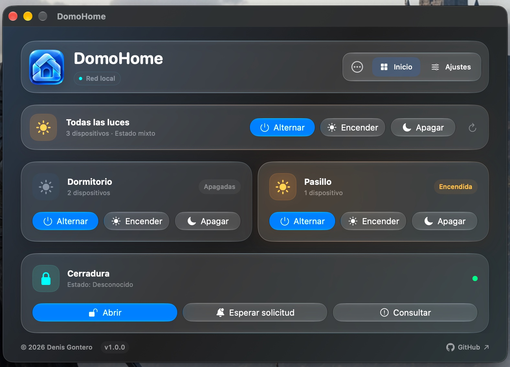
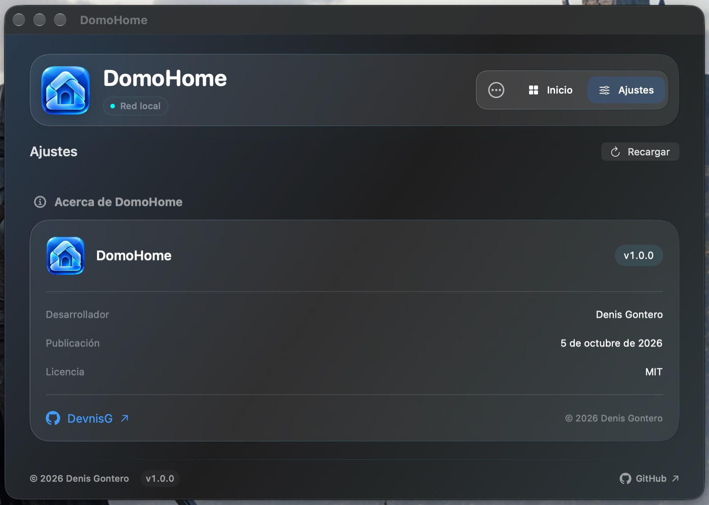
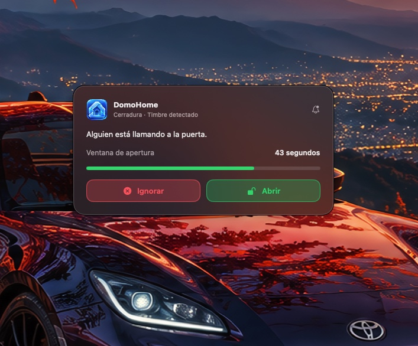
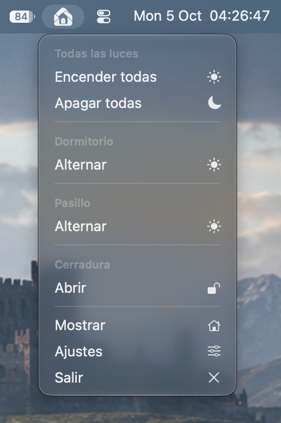

# DomoHome

**Control local de luces Tuya y una cerradura compatible desde macOS.** DomoHome es una app nativa, bilingüe y pensada para la barra de menú, con configuración independiente para cada integración.

**v1.0.0 · 5 de octubre de 2026 · macOS 14 o posterior**

[English](#english)

## Funciones

- Encender, apagar y alternar luces individualmente, por grupo o en conjunto.
- Controlar luces compatibles con Tuya LAN 3.3 en la red local.
- Recibir el timbre Tuya en un modal compacto con Abrir/Ignorar, también en segundo plano, y solicitar apertura manual dentro de una ventana DP9 vigente.
- Consultar una cerradura mediante la API de Tuya Cloud.
- Ejecutar acciones desde la barra de menú o con atajos de teclado globales.
- Elegir español o inglés y personalizar nombres y grupos.

La integración de luces y la de cerradura se configuran por separado. La apertura remota depende de las capacidades del modelo; algunas cerraduras requieren que primero se inicie una solicitud desde el dispositivo.

## Requisitos

- macOS 14 o posterior.
- Xcode con el SDK de macOS para compilar desde el proyecto.
- Para luces: dispositivos compatibles con Tuya LAN 3.3, accesibles en la red local, y sus IP, IDs y claves locales.
- Para cerradura: un proyecto Tuya Cloud con permisos para el dispositivo y sus credenciales.

El diseño usa Liquid Glass cuando está disponible y ofrece materiales nativos como alternativa en versiones anteriores de macOS.

## Empezar

1. Abrí `DomoHome.xcodeproj` en Xcode.
2. Seleccioná el esquema `DomoHome` y ejecutá la app.
3. En **Ajustes → Dispositivos**, agregá las luces o configurá la cerradura.
4. Asigná atajos y elegí idioma y sonido en las secciones correspondientes de Ajustes.

También podés compilar sin configurar una cuenta de firma personal:

```sh
xcodebuild -project DomoHome.xcodeproj \
  -scheme DomoHome \
  -destination 'platform=macOS' \
  CODE_SIGNING_ALLOWED=NO \
  build
```

La firma y notarización necesarias para distribuir una app macOS son un paso separado de la compilación local.

## Timbre Tuya

La recepción es opt-in y requiere preparar el helper autocontenido. Todos los accesos a Abrir, incluido ⌥ C si está asignado, validan una ventana DP9 vigente y una sesión de macOS desbloqueada, sin pedir Touch ID. El antiguo atajo Esperar solicitud ahora funciona como apertura manual alternativa. Las luces locales conservan su integración.

## Desarrollo

Las pruebas de configuración usan datos ficticios y un almacén de credenciales en memoria:

```sh
bash scripts/test-configuration.sh
```

## Licencia y autoría

Distribuido bajo la licencia [MIT](LICENSE). Copyright © 2026 Denis Gontero · [GitHub: DevnisG](https://github.com/DevnisG).

---

## English

**Control Tuya lights and a compatible smart lock from macOS.** DomoHome is a native, bilingual app with a menu bar interface and independent setup for each integration.

**v1.0.0 · October 5, 2026 · macOS 14 or later**

### Features

- Turn lights on, off, or toggle them individually, by group, or all at once.
- Control compatible Tuya LAN 3.3 lights over the local network.
- Check a lock and request an unlock through the Tuya Cloud API.
- Run actions from the menu bar or with global keyboard shortcuts.
- Choose Spanish or English and customize device names and groups.

Lights and the lock are configured independently. Remote unlocking depends on the device model; some locks require a request to be initiated at the device first.

### Requirements

- macOS 14 or later.
- Xcode with the macOS SDK to build the project.
- For lights: Tuya LAN 3.3 compatible devices reachable on the local network, with their IP addresses, device IDs, and local keys.
- For a lock: a Tuya Cloud project authorized for the device and its credentials.

Liquid Glass is used when available, with native materials as a fallback on earlier macOS versions.

### Getting started

1. Open `DomoHome.xcodeproj` in Xcode.
2. Select the `DomoHome` scheme and run the app.
3. Open **Settings → Devices** to add lights or configure a lock.
4. Set shortcuts, language, and sound in the corresponding Settings sections.

You can also build locally without a personal signing account:

```sh
xcodebuild -project DomoHome.xcodeproj \
  -scheme DomoHome \
  -destination 'platform=macOS' \
  CODE_SIGNING_ALLOWED=NO \
  build
```

The signing and notarization required to distribute a macOS app are separate from a local build.

### Tuya doorbell

Opt-in doorbell alerts show a compact Open/Ignore panel, including while the main window is minimized or closed, using a bundled self-contained helper. All opening entry points require a current DP9 window and an unlocked macOS session, without a Touch ID prompt.

### Development

Configuration checks use synthetic data and an in-memory credential store:

```sh
bash scripts/test-configuration.sh
```

### License and author

Released under the [MIT License](LICENSE). Copyright © 2026 Denis Gontero · [GitHub: DevnisG](https://github.com/DevnisG).

---

### Inicio / Home



### Ajustes / Settings



### Alerta de Timbre / Dorbell Alert



### Barra de menú / Menu bar

